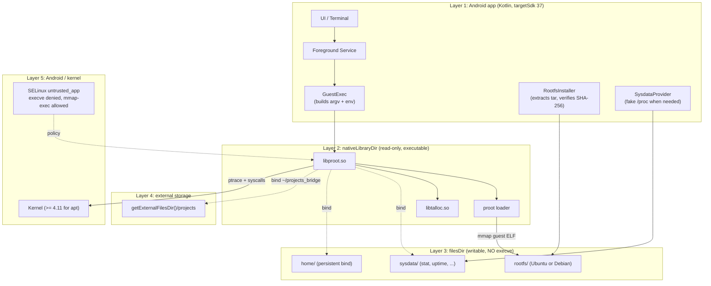
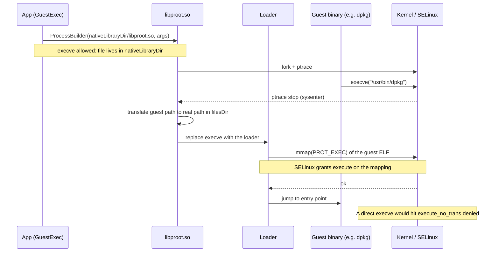
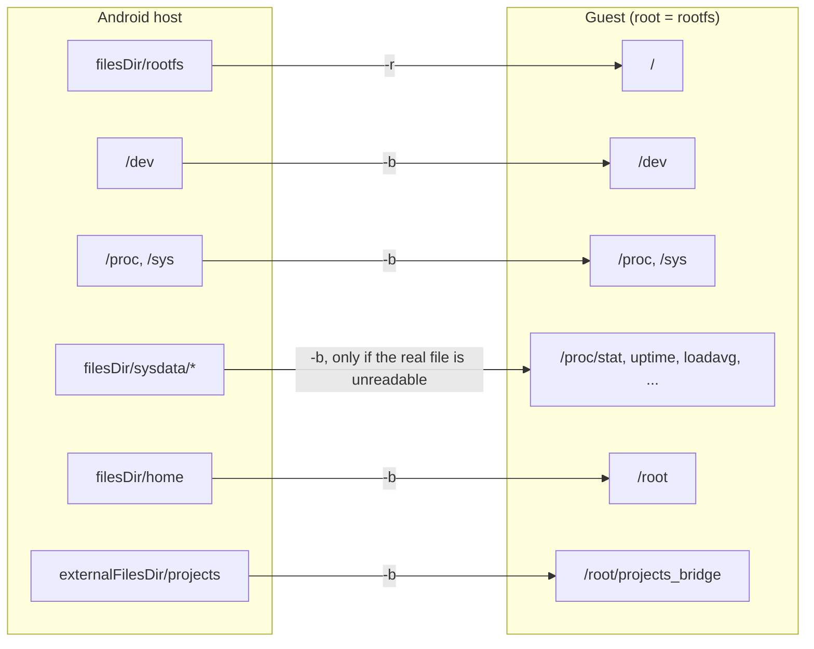
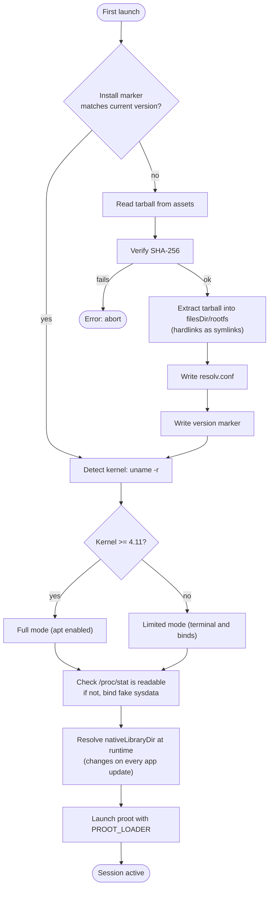

# Architecture

This page describes the intended architecture. The initial repository contains the Android
scaffold, CI, release pipeline, and documentation.

## Layers

```
mobile/                    Android build root
  app/                     Android UI, navigation, and lifecycle
    ui/                    Jetpack Compose screens and theme
    core/                  Shared utilities and result types
    data/                  Settings, storage, and environment metadata
    runtime/               proot process management
    terminal/              Terminal sessions and input handling
    codeserver/            Code Server lifecycle and networking
docs/                      Docusaurus documentation
```

The package root is `dev.prootcode.app`. Layers will be introduced as features are implemented;
the scaffold only contains `ui`.

## Runtime layers

The diagram groups the runtime into five layers. Component names such as `GuestExec`,
`RootfsInstaller` and `SysdataProvider` are proposed names for future modules, not existing code.



## Rootless execution

ProotCode uses proot to intercept system calls and present a Linux root filesystem without
root privileges. Each distribution is installed from a rootfs tarball into app-private storage.

- The Linux root filesystem is isolated from Android.
- Only explicitly bind-mounted Android folders are visible inside Linux.
- A non-root user owns the home directory.
- The home directory is persistent and can be backed up.

### Kernel requirements

Running the distribution does not depend on executing files from app storage: proot maps the
guest binaries instead, which works with `targetSdk 37` on Android 8 through 16.

Package management has an additional requirement. The proot spike showed that apt fails on the
Android 8 image (kernel 3.18) while it works from API 29 (kernel 4.14), so:

- proot, the terminal and bind mounts work on API 26 and later.
- apt, presets and tool installation require kernel 4.11 or newer, with API 29 and later as the
  validated baseline.

Details and raw results are documented in #4.

### Running a guest binary

The app data directory cannot be executed, but it can be mapped. proot relies on that
difference: the loader lives in `nativeLibraryDir`, maps the guest ELF and jumps to its entry
point instead of calling `execve` on it.



## Bind mounts

proot does not mount anything. It rewrites the paths of the traced processes, so every bind is
a mapping between a guest path and an Android path.



## Environment lifecycle



## Distributions

Two products are built from the same code:

- `standard` downloads the rootfs and code-server from the catalog on first use.
- `-Raccoon` bundles Ubuntu 26.04 LTS and code-server for its ABI and works offline.

Raccoon flavors carry only their own architecture because assets are not split by ABI. The
build details and trade-offs are in [ADR 0005](/adr).

## Environment lifecycle

1. The wizard loads the catalog (remote, cached or bundled).
2. The rootfs and optional code-server are downloaded or read from the bundled assets, always
   verified by SHA-256.
3. The rootfs is extracted to `filesDir/environments/<id>/rootfs`; code-server goes to
   `opt/code-server`.
4. `resolv.conf` is written from the active network and `environments.json` records the
   environment, its presets and its size.
5. The projects bridge is verified by writing a probe file through proot.

## Storage model

| Location | Purpose |
|---|---|
| App-private storage | Rootfs, binaries, and runtime state |
| User-selected Android folder | Projects and shared files |
| Linux home | Shell configuration, tools, and project data |
| Downloads bridge | Optional bind mount for the Android Downloads folder |

## Code Server

Code Server runs inside the Linux environment and listens on a local port. The app can expose it
on the device's network interface so another device on the same network can open the editor.

- The server is bound to the Linux home directory.
- VS Code extensions are installed inside the environment.
- Custom CSS adapts the web interface to mobile screens.
- No telemetry or external account is required.

## Security boundaries

- No root access on Android.
- No access to Android app data outside the bind mounts.
- The local network exposure is explicit and can be disabled.
- Secrets and SSH keys stay inside the Linux home unless the user exports them.

## Next

- [Roadmap](/roadmap)
- [Contributing](/contributing)
